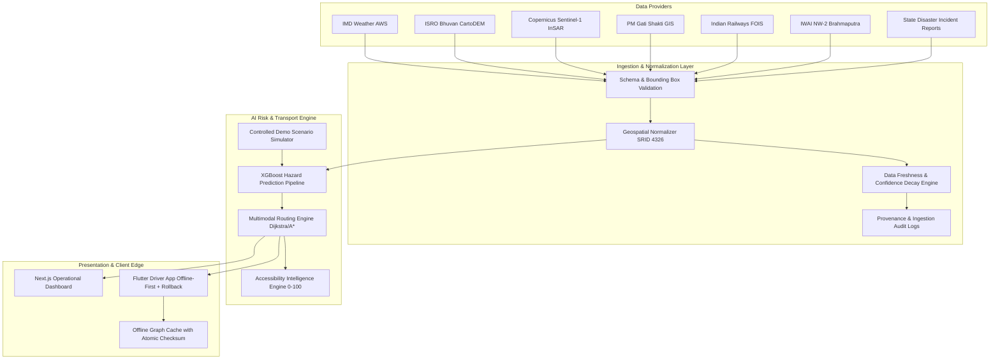

# Phase 6: Real-World Data Integration & Production/Demo Hardening

**Project:** SIH26002  
**Platform:** AI-Based Smart Logistics & Accessibility Intelligence Platform for North Eastern Region (NER)  
**Status:** Implemented, Tested, Hardened, and Verified  
**Date:** September 2026  

---

## 1. Architecture Overview

Phase 6 hardens the SIH26002 platform by bridging realistic North Eastern Region (NER) geospatial/remote-sensing/weather data sources into the existing dynamic routing and offline sync engines.

---

## 2. Provider System Abstractions

All external data sources inherit from `BaseDataProvider` (`apps.ingestion.providers.base.BaseDataProvider`), guaranteeing non-negotiable contract compliance:

| Provider Class | Source Code | Data Domain | Refresh Interval | Provenance Metadata |
|---|---|---|---|---|
| `IMDWeatherProvider` | `IMD_WEATHER` | Automatic Weather Stations (AWS): Rainfall, Humidity, Wind, Severity | 15 min | India Meteorological Dept Regional AWS API |
| `BhuvanTerrainProvider` | `BHUVAN_TERRAIN` | CartoDEM 30m: Elevation, Slope Gradient | 1440 min | ISRO National Remote Sensing Centre (NRSC) |
| `SentinelInSARProvider` | `SENTINEL_INSAR` | InSAR Interferometry: Surface deformation (mm/year) | 720 min | Copernicus Sentinel-1 TOPSAR Geohazard Creep |
| `GatiShaktiRoadProvider` | `GATI_SHAKTI_ROAD` | National Master Plan GIS: Road classification, lane width, bridge status | 360 min | MoRTH / PM Gati Shakti Infrastructure Portal |
| `FOISRailwayProvider` | `FOIS_RAIL` | Freight Operations Info System: Yard congestion, siding availability | 60 min | Indian Railways Centre for Railway Information Systems (CRIS) |
| `IWAIWaterwayProvider` | `IWAI_WATERWAY` | NW-2 Brahmaputra: River stage, LAD (Least Available Depth), draft | 120 min | Inland Waterways Authority of India (IWAI) Pandu Hub |
| `StateDisasterIncidentProvider` | `SDMA_INCIDENTS` | ASDMA / MSDMA: Landslide blocks, flash flood road washouts | 30 min | Assam & Meghalaya State Disaster Management Authorities |

Each provider adheres strictly to:
- Source versioning (`version`)
- Bounded retry behavior (`max_retries=3`, `retry_delay_sec=2.0`)
- Normalization into internal models
- Quality inspection (`QualityReport`) preventing dirty data injection

---

## 3. Data Normalization & Spatial Constraints

All geospatial vectors are normalized into **WGS84 (SRID 4326)** coordinates.

### North Eastern Region Bounding Box Constraint
Any data record outside the official NER corridor bounds is rejected during normalization:
$$\text{Longitude: } [88.0^\circ\text{E}, 97.5^\circ\text{E}], \quad \text{Latitude: } [21.5^\circ\text{N}, 29.5^\circ\text{N}]$$

### Physical Validation Checks
- **Rainfall:** Rejects negative rainfall ($< 0.0$ mm) and unphysical values ($> 500.0$ mm/hr).
- **Slope:** Rejects negative slope or extreme values ($> 90^\circ$).
- **River Draft Depth:** Rejects negative depth ($< 0.0$ m).
- **Surface Displacement:** Flags active slope subsidence when velocity $> 20.0$ mm/year.

---

## 4. Freshness Model & Confidence Decay

Data records are tagged with temporal status and assigned confidence weight multipliers:

| State | Max Age Window | Confidence Factor | Platform Action |
|---|---|---|---|
| `FRESH` | $< 2 \times$ interval | `1.00` | Full weight in XGBoost feature pipeline |
| `AGING` | $2\times - 6\times$ interval | `0.80` | Downgrades prediction confidence score |
| `STALE` | $> 6\times$ interval | `0.50` | Alerts operator; triggers fallback interpolation |
| `INVALID` | Schema / bound failure | `0.00` | Rejected immediately; logged to `IngestionLog` |
| `UNAVAILABLE` | Provider timeout / error | `0.00` | Cached previous observation used with warning flag |

---

## 5. Hazard Prediction Pipeline Integration

Normalized records feed directly into the XGBoost hazard model (`apps.hazards.services.ml_hazard_service`):
- **Feature Vector:** `[rainfall_mm, rain_prob, slope_deg, elevation_m, insar_disp_mm, road_width_m, incident_count]`
- **Contributing Factor Breakdown:**
  - `rainfall_factor`: Normalized 24h precipitation exposure
  - `slope_factor`: Terrain steepness instability
  - `soil_saturation`: Antecedent precipitation index
  - `active_creep`: InSAR millimeter-scale surface displacement
- **Model Versioning:** Every inference returns `model_version: "baseline-v1"`, `feature_version: "fv2-insar"`, and `valid_until: timestamp`.

---

## 6. Realistic Demo Scenario Engine

To enable jury testing without requiring live weather stations or active natural disasters, a **Controlled Scenario Engine** (`DemoScenarioEngine`) is integrated:

### Available Simulation Scenarios
1. `NORMAL`: Baseline dry-season conditions (clear weather, standard transit times, all edges OPEN).
2. `HEAVY_RAIN`: Severe monsoon precipitation across Meghalaya plateau (rainfall $= 110.0$ mm, hazard index jumps to $0.78$, speed reduced by $45\%$).
3. `LANDSLIDE`: Physical landslide blockage on NH-6 / Shillong bypass (edge status `BLOCKED`, hazard index $= 0.95$, emergency reroute generated).
4. `FLOOD`: River stage rise on Brahmaputra floodplain (road edges restricted, draft depth on NW-2 verified).
5. `ROAD_BLOCKAGE`: Vehicle breakdown or clearance blockade on critical segment.
6. `MULTIMODAL_SWITCH`: Heavy road congestion triggering freight transfer from NH-27 to Indian Railways / NW-2 barge.
7. `CRITICAL_CORRIDOR`: Simultaneous dual-corridor hazards testing network resilience.

> [!IMPORTANT]
> All simulated scenarios stamp `is_simulation: true`, log `DemoScenarioRecord`, and can be reset instantaneously to baseline using `POST /api/v1/ingestion/scenarios/reset/`.

---

## 7. Multimodal Logistics Routing Verification

The multimodal routing engine evaluates intermodal transfer nodes (Guwahati Multimodal Hub, Pandu Inland Port, Azara Railway Yard):
- **Mode Switching Cost:** Transfer cost (INR) + Transfer penalty (30–45 min).
- **Physical Feasibility Check:**
  - Heavy trucks ($> 25\text{t}$) excluded from weak suspension bridges and narrow mountain tracks.
  - Barge transport on NW-2 checked against Least Available Depth ($> 2.2\text{m}$).
  - Rail freight restricted to bulk container categories.

---

## 8. Corridor Accessibility Intelligence Engine

The platform computes an objective, multi-factor **Accessibility Index (0–100)**:
$$\text{Accessibility Index} = 0.25 \times S_{\text{connectivity}} + 0.25 \times S_{\text{hazard\_safety}} + 0.25 \times S_{\text{multimodal}} + 0.25 \times S_{\text{hub\_access}}$$

- **Score Interpretation:**
  - $80 - 100$: `HIGH_ACCESSIBILITY` (Resilient, redundant corridors)
  - $50 - 79$: `MODERATE_ACCESSIBILITY` (Vulnerable to severe monsoon weather)
  - $0 - 49$: `CRITICAL_VULNERABILITY` (Single point of failure / severed corridor)
- **Transparency Disclaimer:** Stamped on all outputs: *"Accessibility score represents platform logistical intelligence, not official census statistics."*

---

## 9. API & Security Hardening

- **JWT Authentication:** Strict token rotation and validation.
- **RBAC Enforcement:** `SUPER_ADMIN`, `DISPATCHER`, `OPERATOR`, `DRIVER`.
- **System Health Endpoints:**
  - `GET /api/v1/health/detailed/`: Comprehensive status of Database, PostGIS, ML Registry, Ingestion Providers, and Sync Engine.
- **Data Ingestion Endpoints:**
  - `GET /api/v1/ingestion/providers/`: Registry of external data sources.
  - `GET /api/v1/ingestion/freshness/`: Real-time freshness distribution.
  - `POST /api/v1/ingestion/sync-all/`: Manual synchronization cycle.
  - `GET /api/v1/ingestion/scenarios/`: Available demo scenarios.
  - `POST /api/v1/ingestion/scenarios/activate/`: Trigger scenario.
  - `POST /api/v1/ingestion/scenarios/reset/`: Restore canonical baseline.
  - `GET /api/v1/transport/accessibility/`: Corridor accessibility scoring.

---

## 10. Offline Graph Distribution & Atomic Rollback

In the Flutter mobile client (`frontend/mobile/lib/services/offline_graph_service.dart`):
1. **Version & Checksum Verification:** SHA-256 hash checked before ingestion.
2. **Atomic Replacement:** Active graph is preserved in backup storage keys (`_prefBackupBundleKey`, `_prefBackupChecksumKey`).
3. **Rollback Guarantee:** If a new graph fails validation or is corrupted during transmission, `rollbackToBackup()` restores the previous functioning bundle automatically.

---

## 11. Verification & Test Metrics

- **Backend Ingestion & Scenario Tests:** 21/21 passed (13 unit + 8 integration).
- **Combined Regression Test Suite:** 54/54 passed in 15.01s.
- **Django Health Check:** `python manage.py check` reports 0 issues.
- **Next.js Production Build:** `npm run build` compiled 9/9 pages cleanly.
