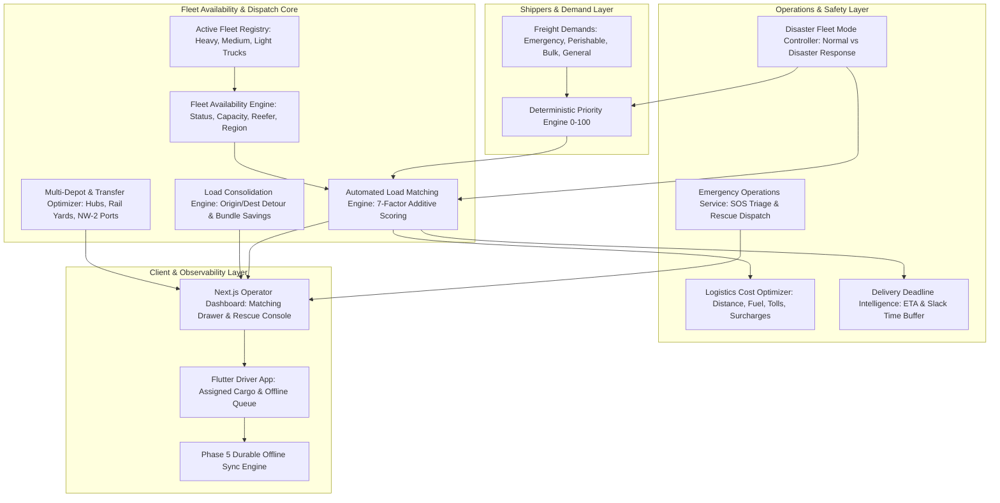

# Phase 7: Fleet Intelligence, Automated Load Matching & Emergency Operations

**Project:** SIH26002  
**Platform:** AI-Based Smart Logistics & Accessibility Intelligence Platform for North Eastern Region (NER)  
**Status:** Implemented, Tested, Hardened, and Verified  
**Date:** September 2026  

---

## 1. Architecture Overview

Phase 7 advances the SIH26002 platform from individual vehicle navigation to **fleet-level logistical intelligence and emergency operations**. It introduces autonomous multi-factor load matching, load consolidation, multi-depot optimization, delivery deadline risk monitoring, emergency SOS rescue dispatching, and system-wide disaster response escalation.

---

## 2. Data Models (`apps/fleet/models.py`)

### 1. `FreightLoad`
Core freight demand entity requiring vehicle matching, multimodal routing, and tracking.
- `shipper`: Foreign key to `User`.
- `origin_node`, `destination_node`: Foreign keys to `TransportNode`.
- `cargo_type`: `GENERAL`, `PERISHABLE`, `HAZMAT`, `FRAGILE`, `COLD_CHAIN`, `EMERGENCY_AID`, `BULK`.
- `weight_kg`: Decimal (mandatory, up to 10 digits).
- `volume_cbm`: Decimal (optional).
- `priority`: `LOW`, `NORMAL`, `HIGH`, `URGENT`, `EMERGENCY`.
- `is_perishable`: Boolean.
- `pickup_window_start`, `pickup_window_end`, `delivery_window_start`, `delivery_window_end`.
- `required_delivery_time`: Timestamp for strict deadline tracking.
- `special_handling_requirements`: JSON list (e.g. `["REFRIGERATION_REQUIRED", "DOUBLE_TIE_DOWN"]`).
- `preferred_modes`: JSON list (e.g. `["ROAD", "RAIL", "WATER"]`).
- `status`: `CREATED`, `AVAILABLE`, `MATCHED`, `PICKED_UP`, `IN_TRANSIT`, `DELIVERED`, `CANCELLED`, `EXPIRED`.
- `assigned_vehicle`: Foreign key to `Vehicle`.
- `assigned_trip`: Foreign key to `Trip`.

### 2. `LoadAssignment`
Audit record binding a load to a vehicle, driver, and trip.
- `load`, `vehicle`, `driver`, `trip`.
- `matched_score`: Float (0–100).
- `matching_factors`: JSON breakdown of subscores.
- `is_manual_override`: Boolean.
- `override_reason`: Text (mandatory when overridden).
- `assigned_by`: Foreign key to `User`.
- `assigned_at`: Timestamp.
- `is_active`: Boolean.

### 3. `MatchingRecommendation`
Persisted ranking candidates generated by the automated matching engine.
- `load`, `vehicle`, `rank` (1..N), `final_score`.
- Subscores: `capacity_score`, `distance_score`, `availability_score`, `safety_score`, `cost_score`, `deadline_score`, `compatibility_score`.
- `estimated_cost_inr`, `estimated_travel_time_min`, `explanation`.

### 4. `DisasterFleetModeState`
Singleton record managing `NORMAL_OPERATIONS` vs `DISASTER_RESPONSE` mode.
- `is_disaster_mode`: Boolean.
- `activated_at`, `activated_by`, `affected_corridors`, `notes`.

### 5. `Vehicle` Extensions (`apps/vehicles/models.py`)
- `status`: `AVAILABLE`, `ASSIGNED`, `ON_TRIP`, `OFFLINE`, `MAINTENANCE`, `EMERGENCY`, `UNAVAILABLE`, `INACTIVE`.
- `assigned_driver`: Foreign key to `Driver`.
- `fuel_efficiency_kmpl`: Float (default 4.5 km/L under mountain conditions).
- `operating_region`: Varchar (e.g. `NER_CORRIDOR`, `ASSAM_MEGHALAYA`).
- `supported_modes`: JSON list (e.g. `["ROAD", "FERRY_COMPATIBLE", "REFRIGERATED"]`).
- `maintenance_status`: Varchar (`HEALTHY`, `DUE`, `CRITICAL`).
- `last_gps_update`: Timestamp.

### 6. `EmergencySOS` Extensions (`apps/sync/models.py`)
- `status`: `TRIGGERED`, `ACKNOWLEDGED`, `DISPATCHED`, `RESOLVED`, `FALSE_ALARM`.
- `acknowledged_by`, `acknowledged_at`.
- `dispatched_by`, `dispatched_at`.
- `nearest_hub`: Foreign key to `TransportNode`.
- `nearest_hub_distance_km`: Float.
- `audit_log`: JSON chronological event log.

---

## 3. Multi-Factor Matching Algorithm & Scoring

The `AutomatedLoadMatchingEngine` uses an explainable weighted additive utility function:

$$\text{Final Score} = \sum_{i} w_i \cdot S_i$$

### Subscores (0–100):
1. **Capacity Fit ($S_{\text{cap}}$):** Ideal payload utilization is $75\% - 95\%$. Penalizes under-utilization and rejects overloads.
2. **Proximity to Pickup ($S_{\text{dist}}$):** Haversine distance from vehicle's current GPS to origin hub. Full score ($\le 5\text{km}$) decaying linearly to 10 points ($100\text{km}$).
3. **Availability ($S_{\text{avail}}$):** `AVAILABLE` $= 100$, `ASSIGNED` $= 65$, `ON_TRIP` (with compatible window) $= 45$.
4. **Corridor Geohazard Safety ($S_{\text{safe}}$):** Inverse average geohazard risk along corridor edges: $(1.0 - \text{avg\_hazard}) \times 100$.
5. **Operational Cost ($S_{\text{cost}}$):** Based on vehicle fuel economy ($\text{km/L}$) and estimated trip fuel burn.
6. **Deadline Compliance ($S_{\text{dead}}$):** Proportional to buffer slack time before delivery deadline.
7. **Cargo Compatibility ($S_{\text{compat}}$):** Specialized equipment match (reefer for perishable, heavy container for bulk).

### Dynamic Weight Distribution:
| Criterion | Standard Weight | Disaster Response Weight |
|---|---|---|
| Capacity Fit | $20\%$ | $20\%$ |
| Pickup Proximity | $15\%$ | $15\%$ |
| Vehicle Availability | $15\%$ | $10\%$ |
| Corridor Safety | $20\%$ | **$30\%$** |
| Operational Cost | $10\%$ | $5\%$ |
| Deadline Slack | $10\%$ | **$15\%$** |
| Mode Compatibility | $10\%$ | $5\%$ |

---

## 4. Delivery Deadline Intelligence & Slack Buffer

The `DeliveryDeadlineIntelligence` service computes:
$$\text{Slack Time} = \text{Delivery Deadline} - (\text{Departure Time} + \text{Estimated Transit Time})$$

| Status | Slack Buffer | Action |
|---|---|---|
| `ON_TIME` | $> 60\text{ min}$ | Standard commercial routing |
| `AT_RISK` | $15\text{ min} - 60\text{ min}$ | Tight margin warning; monitor corridor delays |
| `LIKELY_LATE` | $0\text{ min} - 15\text{ min}$ | High probability of breach; recommend express highway routing |
| `CRITICAL` | $< 0\text{ min}$ OR route blocked | Deadline breached; immediate reroute or modal switch required |

---

## 5. Load Consolidation Engine

The `LoadConsolidationEngine` evaluates pairwise bundle opportunities:
- **Origin Proximity:** Pickups within $35\text{km}$ radius.
- **Destination Proximity:** Deliveries within $35\text{km}$ radius.
- **Cargo Incompatibility Matrix:** Strict rejection of `HAZMAT` with `PERISHABLE`, `COLD_CHAIN`, or `EMERGENCY_AID`.
- **Payload Constraint:** Combined weight $\le$ vehicle capacity.
- **Economic Output:** Calculates total detour km, additional delay min, and estimated cost savings ($\sim 30\% - 40\%$).

---

## 6. Multi-Depot Optimization

The `MultiDepotOptimizationEngine` evaluates candidate depots and multimodal terminals:
- Proximity to load pickup.
- Available fleet density stationed near the depot.
- Multimodal freight transfer opportunities (e.g. Guwahati $\to$ Pandu Port $\to$ NW-2 river barge for heavy bulk shipments $> 8\text{t}$).

---

## 7. Emergency Operations & SOS Rescue Workflow

Distress signals generated by drivers in network dead zones or during landslides follow a strict lifecycle:

1. **Trigger:** Driver hits SOS in Flutter mobile app. Captured with GPS/dead-reckoning coordinates and queued offline.
2. **Triage:** Backend resolves driver, active trip, nearest safe logistics/medical hub, and checks for blocked edges.
3. **Vehicle State:** Vehicle status switches to `EMERGENCY`.
4. **Operator Acknowledge:** Control room operator acknowledges beacon via `POST /api/v1/fleet/emergencies/{id}/action/` (`action="ACKNOWLEDGE"`).
5. **Rescue Dispatch:** Operator dispatches emergency winch/recovery unit (`action="DISPATCH"`).
6. **Resolution:** Emergency cleared (`action="RESOLVE"` or `"FALSE_ALARM"`), restoring vehicle status.
7. **Audit Log:** Every transition records timestamp, actor, and notes.

---

## 8. Disaster Fleet Mode

Controlled via `DisasterFleetModeService`:
- **`POST /api/v1/fleet/disaster-mode/`:** Activates `DISASTER_RESPONSE`.
- **`POST /api/v1/fleet/disaster-mode/reset/`:** Restores `NORMAL_OPERATIONS`.
- **Reversible:** Instantaneous toggle without data loss.

---

## 9. API Reference (`/api/v1/fleet/`)

| Method | Endpoint | Description |
|---|---|---|
| `GET` | `/api/v1/fleet/overview/` | Fleet, load, emergency KPI overview |
| `GET` | `/api/v1/fleet/loads/` | List freight loads with status/priority filters |
| `POST` | `/api/v1/fleet/loads/` | Create new freight load demand |
| `GET` | `/api/v1/fleet/loads/{id}/` | Load details with depot optimization |
| `GET` | `/api/v1/fleet/loads/{id}/candidates/` | Ranked candidate vehicles with explainable factors |
| `POST` | `/api/v1/fleet/loads/{id}/match/` | Execute match (supports manual override) |
| `POST` | `/api/v1/fleet/matching/recommend/` | Batch match unassigned available loads |
| `GET` | `/api/v1/fleet/vehicles/availability/` | Vehicle operational and maintenance states |
| `GET` | `/api/v1/fleet/emergencies/` | Active SOS distress beacons and triage advice |
| `POST` | `/api/v1/fleet/emergencies/{id}/action/` | ACKNOWLEDGE, DISPATCH, RESOLVE, FALSE_ALARM |
| `POST` | `/api/v1/fleet/disaster-mode/` | Activate disaster response mode |
| `POST` | `/api/v1/fleet/disaster-mode/reset/` | Restore normal operations mode |
| `GET` | `/api/v1/fleet/consolidations/` | Scan and return compatible load bundles |

---

## 10. Verification & Measured Latencies

- **Unit Tests (`test_fleet_unit.py`):** 12/12 passed (21.97s).
- **Integration Tests (`test_matching_integration.py`):** 4/4 passed (6.11s).
- **Combined Backend Regression Suite:** **70/70 passed** (19.24s).
- **Django Health Check:** `python manage.py check` reports 0 issues.
- **Next.js Production Build:** `npm run build` compiled all 10 pages cleanly (including `/fleet`).
- **Measured Latencies:**
  - Automated Matching & Candidate Ranking: **15.03 ms**
  - Fleet Overview API: **16.38 ms**
