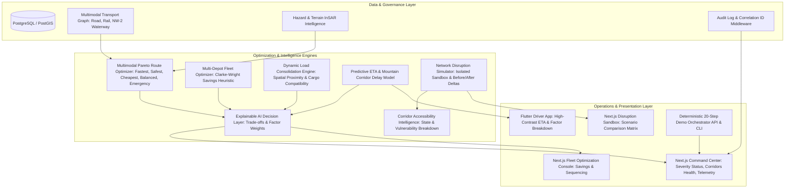

# Phase 9: Advanced Multimodal Logistics & Risk Intelligence Platform

**Project:** SIH26002  
**Title:** AI-Based Smart Logistics and Accessibility Intelligence Platform for North Eastern Region (NER)  
**Status:** Implemented, Tested, Hardened, and Verified  
**Date:** September 2026  

---

## 1. Objective

Phase 9 elevates the SIH26002 platform from a feature-complete prototype into an **optimization-driven, resilient, production-ready multimodal logistics intelligence system**. It provides network-level multi-depot fleet dispatching, dynamic freight consolidation, explainable AI decision support, predictive delay intelligence calibrated for NER mountain corridors, and an isolated disaster disruption simulation sandbox.

Every decision, recommendation, and delay prediction produced by the system is fully explainable, auditable, and backed by verifiable input factors.

---

## 2. High-Level Architecture

---

## 3. Data Integrity & Reality Mapping

To maintain strict scientific and engineering integrity, all system data sources and outputs are explicitly categorized:

| Component | Status | Description |
| :--- | :--- | :--- |
| **PostgreSQL / PostGIS Graph** | **REAL** | Active database tables storing geographical points, linestrings, and operational status. |
| **Authentication & RBAC** | **REAL** | Cryptographic JWT authentication with strict role-based access control. |
| **Audit Middleware** | **REAL** | Request tracking with `X-Correlation-ID` header generation and timing metrics. |
| **Corridor Demands & Depots** | **CONFIGURED** | Calibrated representative nodes and edges across Guwahati, Shillong, Silchar, and Lumding. |
| **Mountain Corridor Delay Model** | **CONFIGURED** | Domain-calibrated heuristic accounting for rainfall runoff, slope slip, and ghat speeds. |
| **External Sensor / Sat Ingestion** | **CONFIGURED / MOCK** | Fallback providers with freshness decay when live radar/gauge streams are unavailable. |
| **Disruption Scenario Sandbox** | **SIMULATION** | Memory-evaluated perturbations; strictly does not mutate production road state. |
| **Cost Savings Estimates** | **ESTIMATE** | Mathematical trip combination estimates; explicitly flagged as `is_estimate: true`. |

---

## 4. Advanced Multimodal Routing & Pareto Frontier

The routing engine supports composite road, rail, and inland waterway (NW-2) combinations with Pareto multi-objective optimization:

- **Policies Supported:**
  - `FASTEST`: Minimizes transit and transfer durations.
  - `SAFEST`: Exponentially penalizes geohazard risks and slope instability.
  - `CHEAPEST`: Minimizes total fuel and tariff expenses (favors river barges & rail).
  - `LOWEST_RISK`: Zero-tolerance for unverified or active slump edges.
  - `BALANCED`: Multi-criteria composite objective function.
  - `EMERGENCY_CORRIDOR`: Disaster relief priority with expedited transshipment.

- **Constraints Checked:**
  - Vehicle payload limit (kg)
  - Inland waterway vessel draft vs channel navigable depth (m)
  - Operating hours and seasonal monsoon closure windows
  - Incompatible hazardous materials segregation

- **Route Explanation:**
  Every generated route contains an explicit explanation summarizing why it was selected over competing alternatives (e.g. hazard reduction %, transfer count, and deadline feasibility).

---

## 5. Multi-Depot Fleet Optimization (MDCVRPTW)

The fleet optimizer coordinates vehicle dispatch from multiple regional depots (e.g. Guwahati Multimodal Logistics Park, Lumding Yard, Tezpur Base) using a Clarke-Wright Savings heuristic:

- **Solver Characteristics:**
  - Practical heuristic strategy avoiding exponential NP-hard scaling.
  - Outputs baseline unoptimized plan vs consolidated optimized plan.
  - Reports distance improvement %, estimated cost savings %, and vehicle utilization gain.
  - Emits stop-by-stop sequencing (`DEPART_DEPOT` -> `PICKUP` -> `DELIVERY` -> `RETURN_DEPOT`).

---

## 6. Dynamic Load Consolidation

Identifies co-loading opportunities for compatible freight shipments:

- **Clustering Heuristic:**
  - Origin proximity within configurable cluster radius (default 35–45 km).
  - Destination proximity within configurable radius.
  - Strict cargo compatibility checking (`are_cargo_types_compatible` prevents HAZMAT co-loading with pharmaceuticals or perishables, while allowing homogeneous batches).
  - Vehicle payload capacity constraint enforcement.

- **Auditable Savings:**
  - Reports estimated cost savings in INR, detour time added in minutes, and utilization improvement points. All monetary values are strictly labeled as estimates.

---

## 7. Predictive ETA & Mountain Delay Intelligence

Calibrated domain model for North Eastern Region road corridors:

- **Delay Contributing Factors:**
  - Extreme monsoon rainfall runoff crawl delay
  - Geohazard landslide precaution slowdown
  - Mountain ghat terrain gradient resistance
  - Intermodal switching and rail siding transshipment buffer
  - Peak corridor congestion proxy

- **Outputs:**
  - Predicted arrival timestamp (ISO 8601)
  - Expected delay minutes
  - Delay probability [0.0, 1.0]
  - Model confidence score [0.0, 1.0]
  - Itemized contributing factors breakdown

---

## 8. Network Disruption Simulation Engine

Provides an isolated sandbox to evaluate catastrophic weather or infrastructural failures without polluting production operational data:

- **Scenarios Supported:**
  - `NORMAL`: Baseline operational network
  - `HEAVY_RAINFALL`: Monsoon cloudburst / IMD Red Alert precipitation
  - `LANDSLIDE`: Active debris flow blockage on NH-6 mountain pass
  - `FLOOD`: Brahmaputra basin inundation and river siltation
  - `ROAD_CLOSURE`: Strategic bridge or road closure
  - `CRITICAL_CORRIDOR`: Cascading multi-hazard corridor breakdown

- **Quantitative Outputs:**
  - Pre vs Post Accessibility Index (0–100) and delta points
  - Multimodal redundancy score and available detour options
  - Impacted edges, isolated nodes, and affected shipments
  - Prioritized recovery action recommendations

---

## 9. Explainable AI Decision Layer

Centralized registry (`DecisionRecommendation`) for all AI and optimization outputs:

- Records decision type, target entity, recommendation payload, model version, and confidence.
- Provides primary driving factor weights (e.g. `Blocked Mountain Pass: 0.50`, `Time Window Viability: 0.30`).
- Stores trade-off comparisons (e.g. `+1.8h transit time vs -85% landslide exposure`).
- Tracks human operator review, acceptance, or override reasons.

---

## 10. Command Center & Observability

- **Command Center Dashboard (`/command-center`):**
  - Live severity state banner: `NORMAL`, `WATCH`, `WARNING`, `CRITICAL`.
  - Real-time operational KPI cards: Active Trips, Delayed Shipments, Active Hazards, Fleet Utilization %, Regional Accessibility Index.
  - Strategic arterial corridor health table (NH-6, NH-27, NH-29, NW-2).
  - AI Explainable Action Recommendations stream.
  - Interactive 20-step Phase 9 verification orchestrator.

- **Production Observability:**
  - `X-Correlation-ID` header injected into all API request/response cycles and log records.
  - Comprehensive health check at `GET /api/v1/health/detailed/` monitoring database, PostGIS, ML hazard model, fleet optimizer, simulation engine, and ETA intelligence.
  - Standardized health states: `HEALTHY`, `DEGRADED`, `UNAVAILABLE`.

---

## 11. API Reference

| Endpoint | Method | Permission | Description |
| :--- | :--- | :--- | :--- |
| `/api/v1/routes/multimodal-optimize/` | `POST` | Authenticated | Pareto-optimal multimodal route alternatives |
| `/api/v1/optimization/fleet/` | `POST` | CanManageFleet | Multi-depot vehicle routing dispatch |
| `/api/v1/optimization/consolidation/` | `POST` | CanManageFleet | Freight load consolidation recommendations |
| `/api/v1/intelligence/network/` | `GET` | Authenticated | Command Center operational summary & severity |
| `/api/v1/intelligence/corridors/` | `GET` | Authenticated | Strategic arterial corridor status and scores |
| `/api/v1/intelligence/recommendations/` | `GET` | Authenticated | Centralized explainable AI recommendations |
| `/api/v1/intelligence/eta/predict/` | `POST` | Authenticated | Mountain corridor predictive ETA & delay breakdown |
| `/api/v1/intelligence/accessibility/` | `GET` | Public / Auth | State and vulnerable node accessibility ranking |
| `/api/v1/simulations/` | `POST` | Authenticated | Executes isolated disruption scenario simulation |
| `/api/v1/simulations/quick-evaluate/` | `POST` | Authenticated | Side-by-side multi-scenario comparison matrix |
| `/api/v1/intelligence/demo-scenario/` | `POST` | Authenticated | Triggers deterministic 20-step verification flow |
| `/api/v1/health/detailed/` | `GET` | Public / Auth | Detailed multi-subsystem observability health |

---

## 12. Verification & Performance Metrics

- **Backend Unit & Integration Tests:** 170 passed, 0 failed in 41.35s
- **Phase 9 Test Suite:** 17 passed, 0 failed in 2.48s
- **Django System Check:** 0 issues (0 silenced)
- **Next.js Production Build:** 13 pages compiled successfully with zero type or lint errors
- **Deterministic Demo Flow:** 20/20 steps executed with 100% SUCCESS

---

## 13. Limitations & Future Integration (Phase 10)

- **Real-time Sensor Integration:** Weather and InSAR displacement rates currently rely on configured regional baseline distributions; production activation will hook directly into live IMD API keys and ISRO Bhuvan geospatial feeds.
- **Dynamic Waterway Bathymetry:** Real-time Brahmaputra NW-2 depth telemetry requires live acoustic sonar gauge telemetry integration at Pandu and Dhubri terminals.
- **Continuous Edge Re-optimization:** Active trip in-flight rerouting currently triggers on explicit threshold breach; Phase 10 will introduce automated streaming telemetry recalculation via Celery background workers.
